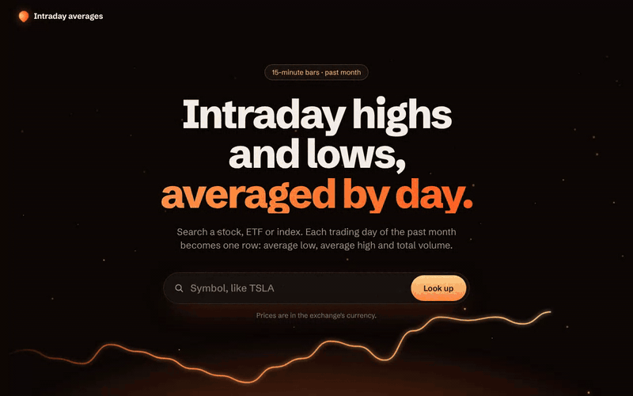
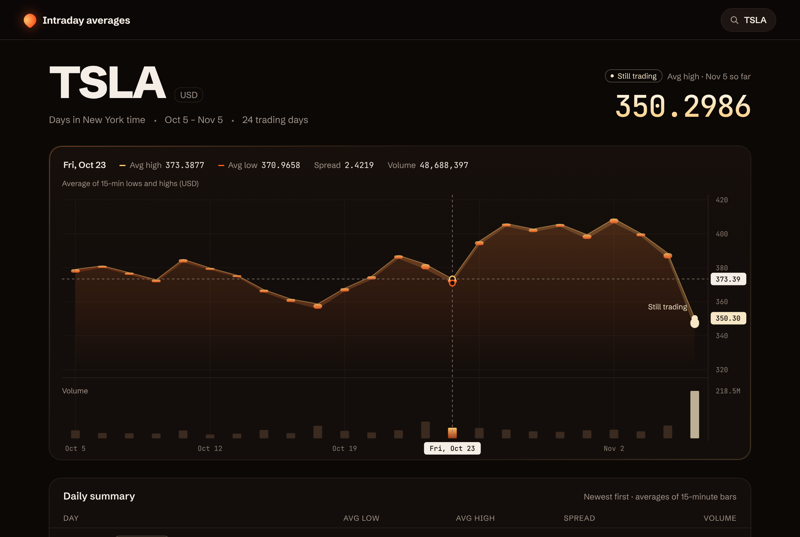

# Intraday Stock Viewer

[](https://github.com/AnushaU1111/IntradayStockViewer/actions/workflows/ci.yml)

Type a stock, ETF or index symbol and get the last month of Yahoo Finance 15-minute data, grouped by trading day: the average of the 15-minute lows, the average of the 15-minute highs and the total volume, rounded to 4 decimals.



```http
GET /api/v1/stocks/TSLA/daily-summary
```

```json
[
  { "day": "2026-11-03", "lowAverage": 398.4825, "highAverage": 400.1821, "volume": 32274494 },
  { "day": "2026-11-04", "lowAverage": 385.5077, "highAverage": 388.5708, "volume": 58867385 }
]
```

## Run it

**Prerequisites:** [Git](https://git-scm.com/downloads) and [Node.js 24](https://nodejs.org/) (`.nvmrc` pins 24.14.1; npm comes with Node). With nvm, run `nvm install` in the repo folder.

```bash
git clone https://github.com/AnushaU1111/IntradayStockViewer.git
cd IntradayStockViewer
npm ci
npm run dev
```

Open http://localhost:5173. `npm run dev` starts the API on port 3001 and the Vite dev server on 5173, which proxies `/api` to the API. No API key or configuration is needed; every setting has a working default (see [Configuration](#configuration)).

To run the browser tests too, install Chromium once with `npx playwright install chromium`, then run `npm run test:e2e`.

Open http://localhost:5173. `npm run dev` starts the API on port 3001 and the Vite dev server on 5173, which proxies `/api` to the API. No API key or configuration is needed; every setting has a working default (see [Configuration](#configuration)).



The screenshot and GIF use the committed TSLA fixture at the in-session test clock (2026-11-05 18:00 UTC), which is why Nov 5 shows "Still trading".

## How to review

| Requirement in the brief                     | Where it lives                                                                                                                 | Proven by                                                                                                                                |
| -------------------------------------------- | ------------------------------------------------------------------------------------------------------------------------------ | ---------------------------------------------------------------------------------------------------------------------------------------- |
| Fetch 15-minute intraday data from Yahoo     | [`yahooClient.ts`](backend/src/providers/yahoo/yahooClient.ts), [`yahooMapper.ts`](backend/src/providers/yahoo/yahooMapper.ts) | [`yahooClient.test.ts`](backend/test/providers/yahooClient.test.ts), [`yahooMapper.test.ts`](backend/test/providers/yahooMapper.test.ts) |
| Last month only                              | [`window.ts`](backend/src/domain/window.ts)                                                                                    | [`window.test.ts`](backend/test/domain/window.test.ts)                                                                                   |
| Group by day, in the exchange's own time     | [`dayKey.ts`](backend/src/domain/dayKey.ts), [`aggregateDaily.ts`](backend/src/domain/aggregateDaily.ts)                       | [`dayKey.test.ts`](backend/test/domain/dayKey.test.ts), [`aggregateDaily.test.ts`](backend/test/domain/aggregateDaily.test.ts)           |
| Average lows and highs, sum volume           | [`aggregateDaily.ts`](backend/src/domain/aggregateDaily.ts)                                                                    | [`golden.test.ts`](backend/test/domain/golden.test.ts) against an independent Python oracle                                              |
| 4-decimal precision                          | [`rounding.ts`](backend/src/domain/rounding.ts) (decimal.js, half up)                                                          | [`rounding.test.ts`](backend/test/domain/rounding.test.ts), including ties that plain floats round wrong                                 |
| `[{ day, lowAverage, highAverage, volume }]` | [`stocks.routes.ts`](backend/src/http/stocks.routes.ts), [`dto.ts`](packages/shared/src/dto.ts)                                | [`dailySummary.route.test.ts`](backend/test/http/dailySummary.route.test.ts)                                                             |
| A UI to view the results                     | [`frontend/src`](frontend/src)                                                                                                 | [`frontend/test`](frontend/test) and the [real-stack e2e suite](e2e/dailySummary.spec.ts)                                                |
| Tests                                        | 358 unit and integration tests, 8 browser tests                                                                                | [CI](.github/workflows/ci.yml): three host timezones plus e2e                                                                            |
| AI prompt log                                | [PROMPT_LOG.md](PROMPT_LOG.md)                                                                                                 | Every exchange, with what was kept, changed or rejected                                                                                  |
| Decisions and tradeoffs                      | [DECISIONS.md](DECISIONS.md)                                                                                                   | Each decision with why it was needed and the tradeoff accepted                                                                           |

## Three judgment calls worth reading

1. **The 16:00 closing-price stub ([D-50](DECISIONS.md#d-50-keep-only-bars-inside-the-regular-session-phase-2)).** The captured Yahoo data ends each latest day with an extra bar at 16:00 ET where low equals high equals the close and volume is 0. Averaging it in skews that day's averages, and no spec rule covered it. The fix keeps only bars inside Yahoo's own `tradingPeriods`, rather than dropping zero-volume or flat bars, which would also remove real quiet bars. A live run against Yahoo after the close matched the golden file exactly, and would not have with the stub.
2. **`new Date(day)` shows the wrong date ([D-36](DECISIONS.md#d-36-ui-renders-api-facts-never-infers-market-state-15)).** `new Date("2026-11-02")` is midnight UTC, which is Nov 1 everywhere in the Americas. The UI never builds a Date from `day`: it splits the string and computes the weekday arithmetically, and ESLint bans `new Date` in app code. The browser tests run in Honolulu and Tokyo, and reintroducing the bug fails only in Honolulu.
3. **Tests that are shown to fail ([D-56](DECISIONS.md#d-56-frontend-details-phase-6), [D-57](DECISIONS.md#d-57-real-stack-e2e-details-phase-7)).** Each phase ended with mutation checks: the code was broken on purpose and the suite had to catch it. One check in Phase 3 survived, which exposed a test that passed only because of bar order, and the test was fixed. At the end-to-end level, a fake Yahoo server that ignores the request window, or both runs sharing one clock, fail the in-session tests.

## Architecture

```text
browser ── /api ──> Fastify route ──> service ──> cache ──> upstream guard ──> Yahoo client ──> Yahoo
                         │                │                (deadline, retries,   (fetch, zod schema,
                     problem+json    pure domain             cooldown)            mapper)
                     errors          aggregateDaily
                                     (window, day keys,
                                      rounding, partial day)
```

- **npm workspaces:** `packages/shared` (symbol validation, error codes, response types, used by both sides), `backend` (Fastify API) and `frontend` (React with Vite).
- **Pure domain.** `aggregateDaily(bars, info, now)` has no I/O and takes the clock as an argument, so every time rule is testable with a fixed `now`.
- **Upstream resilience.** One 8 s deadline across all attempts, retries only for 5xx, network errors and timeouts, and a circuit-breaker-style cooldown that honors Yahoo's `Retry-After`.
- **Cache.** Stores Yahoo's data, not computed results, so the window and the "still trading" day are recomputed on every request.
- **Frontend.** One typed API client, TanStack Query for cancellation, and a hand-built SVG chart. The UI shows only what the API states; it never works out market hours itself.

## API

### `GET /api/v1/stocks/{symbol}/daily-summary`

Returns a JSON array with one object per trading day in the window, oldest first. The window runs from one calendar month before today, in the exchange's timezone, through today.

| Field         | Type   | Meaning                                               |
| ------------- | ------ | ----------------------------------------------------- |
| `day`         | string | Exchange-local calendar date, `YYYY-MM-DD`            |
| `lowAverage`  | number | Mean of the day's 15-minute lows, at most 4 decimals  |
| `highAverage` | number | Mean of the day's 15-minute highs, at most 4 decimals |
| `volume`      | number | Sum of the day's 15-minute volumes                    |

The body stays exactly that shape. Context travels in headers:

| Header                | Meaning                                                        |
| --------------------- | -------------------------------------------------------------- |
| `X-Exchange-Timezone` | IANA zone the days are keyed in, such as `America/New_York`    |
| `X-Currency`          | Price currency, when Yahoo provides one                        |
| `X-Partial-Day`       | Today's date, only while today's session is still open         |
| `X-Request-Id`        | Echoed when well formed, otherwise generated; also in the logs |

Symbols are 1 to 32 characters: letters, digits and `. & = -`, with an optional leading `^` for indices. They are checked before uppercasing, so lookalike Unicode letters can't pass. Equities, ETFs and indices are supported.

### Errors

Every error is `application/problem+json` with a stable `code`:

```json
{
  "type": "about:blank",
  "title": "Not Found",
  "status": 404,
  "detail": "No market data found for ZZZZ.",
  "code": "SYMBOL_NOT_FOUND",
  "requestId": "…"
}
```

| Status | `code`                   | When                                                                              |
| ------ | ------------------------ | --------------------------------------------------------------------------------- |
| 400    | `INVALID_SYMBOL`         | The symbol fails validation                                                       |
| 400    | `BAD_REQUEST`            | A malformed request; a path parameter over 256 characters gets 414 with this code |
| 404    | `SYMBOL_NOT_FOUND`       | Yahoo has no such symbol                                                          |
| 404    | `NOT_FOUND`              | No such endpoint                                                                  |
| 422    | `UNSUPPORTED_INSTRUMENT` | Not an equity, ETF or index; `instrumentType` names what it is                    |
| 422    | `INTRADAY_UNAVAILABLE`   | No 15-minute data, as for mutual funds                                            |
| 429    | `RATE_LIMITED`           | Over the per-IP limit                                                             |
| 500    | `INTERNAL_ERROR`         | An unexpected error                                                               |
| 502    | `UPSTREAM_REJECTED`      | Yahoo answered with another 4xx                                                   |
| 502    | `UPSTREAM_BAD_RESPONSE`  | Yahoo's payload failed validation                                                 |
| 502    | `UPSTREAM_UNAVAILABLE`   | Yahoo returned 5xx or couldn't be reached; 503 while the cooldown is active       |
| 503    | `UPSTREAM_RATE_LIMITED`  | Yahoo returned 429                                                                |
| 503    | `UPSTREAM_BLOCKED`       | Yahoo returned 401 or 403                                                         |
| 503    | `SERVER_BUSY`            | Reserved for the global upstream limiter, which isn't built yet                   |
| 504    | `UPSTREAM_TIMEOUT`       | The 8 s deadline passed                                                           |

Every 429 and 503 carries `Retry-After`. The UI counts down from it for that symbol only, and never retries an HTTP error by itself.

### Health

`GET /health/live` and `GET /health/ready` never call Yahoo and are exempt from the rate limit.

## Configuration

The API reads environment variables, or `backend/.env` (copy [`backend/.env.example`](backend/.env.example)). Empty values count as unset.

| Variable                      | Default                            | Meaning                                                                  |
| ----------------------------- | ---------------------------------- | ------------------------------------------------------------------------ |
| `HOST`, `PORT`                | `0.0.0.0`, `3001`                  | Where the API listens                                                    |
| `YAHOO_BASE_URL`              | `https://query1.finance.yahoo.com` | Upstream base URL; the e2e tests point it at the fake server             |
| `YAHOO_USER_AGENT`            | a desktop Chrome string            | Sent to Yahoo                                                            |
| `UPSTREAM_TOTAL_TIMEOUT_MS`   | `8000`                             | One deadline for every attempt and backoff                               |
| `UPSTREAM_ATTEMPT_TIMEOUT_MS` | `3000`                             | Per attempt; may not exceed the total                                    |
| `UPSTREAM_RETRIES`            | `2`                                | Retries for 5xx, network errors and timeouts only                        |
| `UPSTREAM_COOLDOWN_SECONDS`   | `30`                               | Cooldown and `Retry-After` fallback when Yahoo sends none                |
| `UPSTREAM_MAX_RPS`            | `2`                                | Read but unused until the global limiter ships                           |
| `CACHE_TTL_SECONDS`           | `60`                               | Cache lifetime for data and 422 results                                  |
| `CACHE_NOT_FOUND_TTL_SECONDS` | `30`                               | Cache lifetime for 404 results                                           |
| `RATE_LIMIT_PER_MINUTE`       | `60`                               | Per-IP limit                                                             |
| `TRUST_PROXY`                 | `false`                            | `false`, or the exact IP or CIDR of a reverse proxy; numbers are refused |
| `CORS_ORIGINS`                | empty (same origin only)           | Comma-separated origins for a split deployment                           |
| `CLOCK_FIXED_AT`              | unset                              | Fixes the clock for tests; refused unless `NODE_ENV=test`                |
| `LOG_LEVEL`                   | `info`                             | Pino log level                                                           |

The frontend has no configuration: it calls the relative path `/api`, so the same build works behind any host.

## Tests

```bash
npm test            # unit and integration: shared, backend, frontend (358 tests)
npm run test:e2e    # real stack in Chromium, two clock scenarios (8 tests)
npm run lint        # ESLint, strict type-checked rules
npm run typecheck   # TypeScript across every workspace and e2e
npm run build       # shared, backend and frontend
```

The first e2e run needs a browser: `npx playwright install chromium`.

- **Independent oracle.** Expected values come from [`scripts/golden.py`](scripts/golden.py), which recomputes the averages with Python's `Decimal` from the captured fixtures, never from the code under test.
- **Fixed clocks.** The fixtures carry fixed dates, so tests pin time: 2026-11-05 21:30 UTC (after the close) and 18:00 UTC (during the session). The API honors `CLOCK_FIXED_AT` only under `NODE_ENV=test`.
- **Timezone matrix.** CI runs every unit suite with the host in UTC, Pacific/Kiritimati (UTC+14) and America/Los_Angeles. The browser tests run in Pacific/Honolulu and Asia/Tokyo.
- **Real stack.** The e2e suite builds the API and the UI and runs them against a fake Yahoo server that serves the captured fixtures, cut to exactly the window the API asked for. Nothing is mocked between the browser and the API.
- **No real Yahoo calls in CI.** `npm run smoke:live` checks the live API by hand; it matched the golden file exactly after the 2026-11-05 close.

## Known limitations

- **Unofficial upstream.** Yahoo's chart API is undocumented and can change or block clients without notice. The schema check turns surprises into 502 `UPSTREAM_BAD_RESPONSE` instead of wrong numbers, but there is no second data source.
- **Equities, ETFs and indices only.** Crypto, currencies and futures trade on sessions that don't map cleanly to exchange days, so they get 422 rather than possibly wrong groupings.
- **In-memory state.** The cache, rate limit and cooldown live in one process. Running several instances needs a shared store such as Redis.
- **No live updates.** A day that is still trading is marked and refreshed when you search again; it doesn't stream.
- **Should-tier items not built:** the global upstream limiter (`SERVER_BUSY`), request coalescing, URL history, quick-pick symbols and the Docker and nginx setup.
- **Market-hours capture.** Assumption A-05 (whether the last bar during the session is a live tick) was tested with fixtures sliced to an in-session clock, not with a capture taken during market hours.

## What I'd do next

1. Ship the global upstream limiter and request coalescing, so many users searching at once can't get the server blocked by Yahoo.
2. Add URL history (`?symbol=TSLA`) and quick-pick symbols, so results are shareable and the first search is one click.
3. Package it with Docker and nginx (same-origin serving, CSP and proxy trust are already designed for it).
4. Move cache, cooldown and rate-limit state behind Redis for multiple instances.
5. Add a second data source to cross-check Yahoo, and support crypto with its own day rules.

## Repository

```text
packages/shared   symbol validation, error codes and response types shared by API and UI
backend           Fastify API: providers, pure domain, service, HTTP layer, tests and fixtures
frontend          React UI: API client, components, hooks and tests
e2e               fake Yahoo server, Playwright config and real-stack tests
scripts           fixture capture, golden oracle, dev runner and live smoke check
```
